# GitHub MCP Server – Connecting AI Assistants to Authenticated Developer Data

### IN PARTIAL FULFILLMENT OF THE REQUIREMENT FOR THE AWARD OF DEGREE OF
### MASTER OF COMPUTER APPLICATIONS

**Submitted By:**  
**Pranjay (Enrollment No. ________________)**

<br/>


**VIVEKANANDA SCHOOL OF INFORMATION TECHNOLOGY**  
**VIVEKANANDA INSTITUTE OF PROFESSIONAL STUDIES TC**  

*Affiliated To*  


**Guru Gobind Singh Indraprastha University**  
**Sector - 16C Dwarka, Delhi – 110078**

---

## ACKNOWLEDGEMENT

It is our proud privilege to express our profound gratitude to the entire management of Vivekananda Institute of Professional Studies – Technical Campus and teachers at the institute for providing us with the opportunity to avail the excellent facilities and infrastructure. The knowledge and values inculcated have proved to be of immense help at the very start of my career. Special thanks to Hon’ble Founder, Vivekananda Institute of Professional Studies- Technical Campus, Delhi for having provided us with excellent infrastructure at VSIT.

I am deeply grateful to Prof. Mamta Madan (Dean, VSIT), and my respected Project Guide for their astute guidance, constant encouragement and sincere support for this project work. Their insightful feedback, methodological critiques, and high technical standards were instrumental in shaping the architecture and implementation of this project.

I also take this opportunity to thank the faculty members of the Department of Computer Applications for their collective support and for imparting the theoretical and practical foundations of distributed systems and software engineering.

Sincere thanks to all my family members, seniors and friends for their continuous encouragement and assistance throughout the project development lifecycle.

Finally, I acknowledge the open-source community behind the Model Context Protocol (MCP) specification, Python Software Foundation, and GitHub REST API platform, whose open standards and transparent documentation made this research and development possible.

**Pranjay**  
*Enrollment No. ________________*

---

## CERTIFICATE

This is to certify that the project entitled **“GitHub MCP Server: Connecting AI Assistants to Authenticated Developer Data”**, submitted in partial fulfilment of the Master of Computer Application degree at Vivekananda Institute of Professional Studies – Technical Campus (VIPS-TC), has been completed by **Pranjay (Roll No. ________________)**.

This is an authentic piece of work carried out by him under my guidance. To the best of my knowledge and belief, the material presented in this project has not been submitted earlier for the award of any degree or diploma to any other university or institution.

<br/><br/>

**Signature of student** &emsp;&emsp;&emsp;&emsp;&emsp;&emsp;&emsp;&emsp;&emsp;&emsp;&emsp;&emsp;&emsp;&emsp; **Signature of the guide**  
&emsp;&emsp;&emsp;&emsp;&emsp;&emsp;&emsp;&emsp;&emsp;&emsp;&emsp;&emsp;&emsp;&emsp;&emsp;&emsp;&emsp;&emsp;&emsp;&emsp;&emsp;&emsp;&emsp;&emsp; *(Project Guide)*

<br/>

**Head of Department (VSIT)**  
*Prof. Mamta Madan*

---

## SELF CERTIFICATE

This is to certify that the project report entitled **“GitHub MCP Server: Connecting AI Assistants to Authenticated Developer Data”** done by me is an authentic work carried out for the partial fulfilment of Master of Computer Applications under the guidance of my project guide.

The matter embodied in this project work has not been submitted earlier for award of any degree or diploma to the best of my knowledge and belief.

I declare that all concepts, code snippets, architectural designs, benchmarks, and experimental data presented in this report represent my original work, developed using official standards and documentation with appropriate citations where external open-source libraries have been utilized.

<br/><br/>

**Signature of the student**  
**Pranjay**  
**Enrollment No. ________________**  
**Date: ________________________**  
**Place: New Delhi**

---

## TABLE OF CONTENTS

| S.NO | TOPIC | PAGE NO. |
| :--- | :--- | :--- |
| **1.** | **SYNOPSIS**<br/>• Introduction<br/>• Problem Statement<br/>• Why is this Particular Topic Chosen?<br/>• Key Functionalities<br/>• Theoretical Foundation<br/>• User Centric Design<br/>• Development Methodology<br/>• Future Enhancements | **6 - 9** |
| **2.** | **MAIN REPORT**<br/>2.1 Objective and Scope of the Project<br/>2.2 Theoretical Background & Definition of the Problem<br/>2.3 System Analysis & Design vis-a-vis User Requirements<br/>2.4 System Planning (PERT Chart Schedule)<br/>2.5 Methodology Adopted<br/>2.6 System Implementation<br/>2.7 Details of Hardware and Software<br/>2.8 System Maintenance & Evaluation<br/>2.9 Detailed Lifecycle of the Project<br/>&nbsp;&nbsp;&nbsp;&nbsp;2.9.1 Architecture, ERD, and DFD (Level 0 and Level 1)<br/>&nbsp;&nbsp;&nbsp;&nbsp;2.9.2 Input and Output Screen Design<br/>&nbsp;&nbsp;&nbsp;&nbsp;2.9.3 Methodology Used for Testing<br/>&nbsp;&nbsp;&nbsp;&nbsp;2.9.4 Testing and Quantitative Test Results | **10 - 22** |
| **3.** | **CODING AND SCREENSHOTS**<br/>• Complete Core Code Listings (config.py, github_client.py, server.py)<br/>• Automated Test Suites<br/>• Live System Execution Screenshots | **23 - 33** |
| **4.** | **CONCLUSION** | **34** |
| **5.** | **FUTURE SCOPE** | **35** |
| **6.** | **REFERENCES** | **36** |

---

# 1. SYNOPSIS

### INTRODUCTION
In modern software engineering, Large Language Models (LLMs) such as Claude 3.5 Sonnet, GPT-4o, and Google Gemini 1.5 Pro have fundamentally transformed how developers write, debug, and review code. These frontier AI models possess profound reasoning capabilities over general programming syntax, algorithmic problem solving, and public open-source libraries. However, they suffer from a critical architectural limitation: they are strictly isolated from private, authenticated developer environments.

When software developers operate within professional ecosystems, the vast majority of their high-value context—such as private repositories, proprietary bug trackers, pull request review comments, commit histories, and deployment pipelines—resides securely behind institutional firewalls and authentication mechanisms on GitHub. A software engineer cannot ask an AI assistant basic project management questions, such as: "How many open issues across all my private repositories currently require attention?", "Which issues in my flagship project have remained stagnant for over thirty days?", or "Draft a detailed bug report for the authentication service and confirm before posting." Because standard LLMs have no access to authenticated API endpoints, they either hallucinate responses or politely decline.

To overcome this foundational barrier, **GitHub MCP Server: Connecting AI Assistants to Authenticated Developer Data** is engineered as a standardized, protocol-compliant Model Context Protocol (MCP) server. Open-sourced by Anthropic in November 2024, the Model Context Protocol defines an open, universal communication standard for exposing local and remote tools, passive resources, and conversational prompts to generative AI assistants.

This project implements a Python-based MCP server running as a local sibling process alongside AI desktop clients (such as Claude Desktop and the MCP Inspector developer harness). Operating strictly over local standard input/output (stdio) streams via the JSON-RPC 2.0 protocol, the server acts as an authenticated bridge to the GitHub REST API. The system exposes seven purpose-built tools: five read-only tools for repository browsing, issue triage, cross-repository aggregation, and stale issue tracking, alongside two write tools (issue creation and issue labeling) protected by an immutable Human-in-the-Loop dry-run safety pattern.

By combining Systems Engineering, Secure Credential Isolation, Defensive API Design (RFC 5988 pagination and rate-limit mitigation), and Empirical AI Evaluation across a 50-question multilingual benchmark, this project demonstrates an open, zero-cost, and privacy-preserving paradigm for AI-assisted software engineering.

### PROBLEM STATEMENT
In contemporary developer workflows, software engineers frequently transition between fragmented tools: terminal CLI utilities (`gh`, `git`), web browser tabs (GitHub dashboard, pull requests), and conversational AI interfaces. When attempting to triage bugs or analyze repository health using an AI assistant, developers are forced to manually execute terminal queries, copy-paste raw JSON or table outputs into chat windows, and format the context themselves. This manual copy-pasting is error-prone, violates developer flow state, and discards rich metadata.

Furthermore, proprietary solutions attempting to bridge this gap typically rely on cloud-hosted SaaS plugins. These commercial plugins require developers to upload sensitive Personal Access Tokens (PATs) or enterprise credentials to third-party cloud servers. This introduces grave cybersecurity risks, potential secret leaks, and violations of organizational compliance policies. Simultaneously, unrestricted tool execution presents a severe danger: if an autonomous LLM is given unconditional write permissions, an ambiguous prompt or prompt injection attack could inadvertently trigger catastrophic repository mutations, mass issue deletion, or unwanted labeling.

Therefore, there is an urgent and authentic need for an open-standard, locally executed server that gives AI assistants live, authenticated, and granular access to GitHub developer data—with zero cloud dependencies, zero token exposure, and strict safety guardrails preventing unconfirmed data mutations.

### WHY IS THIS PARTICULAR TOPIC CHOSEN?
This project was selected because the Model Context Protocol represents the single most significant architectural paradigm shift in generative AI tooling since the introduction of Function Calling in 2023. Prior to MCP, connecting an AI model to an API required building bespoke, platform-locked plugins (e.g. OpenAI GPT Actions) that could not be shared across different AI clients.

GitHub was chosen as the target platform because it is the global bedrock of software engineering, hosting over 100 million developers and hundreds of millions of code repositories. Providing AI assistants with structured, safe, and live GitHub access addresses immediate, daily developer pain points.

From an academic perspective within the Master of Computer Applications (MCA) curriculum, this topic uniquely intersects Systems Programming (process spawning, stdio stream manipulation, IPC), Network Protocols (JSON-RPC 2.0 framing, RFC 5988 web linking), Cybersecurity (Principle of Least Privilege, secret hygiene via `.env`), and Empirical Artificial Intelligence (semantic tool routing evaluation, multilingual prompt disambiguation).

### KEY FUNCTIONALITIES
The GitHub MCP Server exposes seven production-grade tools designed for optimal developer utility and absolute safety:
1. **Repository Discovery (`list_repos`):** Retrieves all public and private repositories owned by the authenticated user, reporting star counts, forks, primary programming language, visibility, and ISO-8601 updated timestamps.
2. **Single-Repo Issue Inspection (`list_open_issues`):** Fetches open issues for a specific repository, supporting optional label filters. Critically, it implements algorithmic filtering to separate pull requests from true issues, resolving a notorious GitHub API quirk.
3. **Cross-Repo Search Aggregation (`count_open_issues_all`):** Executes Lucene-syntax queries via the GitHub Search API (`/search/issues`) to aggregate open issue counts across all owned repositories in a single round-trip, bypassing rate-heavy serial loops.
4. **Repository Health Summary (`get_repo_summary`):** Generates a high-level executive dashboard combining repository metrics, the 5 most recent default-branch commits, and all currently open pull requests with author attributions.
5. **Stale Backlog Detection (`stale_issues`):** Evaluates repository issue backlogs against a customizable day threshold (defaulting to 30 days) to highlight dormant or neglected tasks requiring immediate developer triage.
6. **Safe Issue Creation (`create_issue`):** Creates new repository issues with title, body, and labels. Enforces an automatic dry-run preview (`confirm=False` by default) requiring explicit human confirmation (`confirm=True`) before committing state changes.
7. **Safe Label Assignment (`add_label`):** Attaches categorization labels to existing issues with a dry-run preview mechanism to prevent erroneous tagging.

### THEORETICAL FOUNDATION
The project is grounded in four foundational pillars of modern computer science:
1. **Model Context Protocol (MCP) Specification:** MCP standardizes AI client-server communication using JSON-RPC 2.0. Rather than exposing raw REST endpoints directly to an LLM, tools are declared with JSON Schema parameter definitions and semantic docstrings. The LLM parses these schemas and emits structured tool invocations.
2. **Principle of Least Privilege:** In accordance with NIST SP 800-53 security standards, the server operates exclusively with fine-grained GitHub Personal Access Tokens scoped to minimum viable permissions: Issues (Read/Write), Pull Requests (Read-Only), and Metadata (Read-Only). No administrative, repository-deletion, or sensitive account permissions are ever requested.
3. **Human-in-the-Loop (HITL) Dry-Run Pattern:** To counter LLM non-determinism, mutating operations mandate a two-stage transaction lifecycle: Preview Phase (`confirm=False`) followed by Execution Phase (`confirm=True`).
4. **Protocol Stream Isolation:** In stdio transport, stdout is the physical bus for JSON-RPC messages. Any stray logging causes fatal protocol deserialization crashes. The server isolates all diagnostic telemetry strictly to stderr.

### USER CENTRIC DESIGN
The system is engineered for zero-friction developer interaction. Developers do not write complex API queries; they converse with their AI assistant naturally in English, Hindi, or Hinglish (e.g. *"Mere saare open issues dikhao"*). The AI assistant transparently dispatches the appropriate MCP tool, receives structured text, and synthesizes answers seamlessly.

When a write tool is invoked, the user is presented with a clear, visual markdown preview showing exact target repositories, titles, bodies, and tags, followed by an explicit confirmation prompt. If an API rate limit is reached, the system displays the exact reset time in UTC rather than crashing.

### DEVELOPMENT METHODOLOGY
The project adopted the Agile Iterative Methodology organized into 10 structured sprints across 13 weeks. Development progressed from credential security and HTTP client scaffolding to tool definition, stdio stream hardening, benchmark curation, and rigorous prompt optimization.

### FUTURE ENHANCEMENTS
Planned future evolutions include: (1) OAuth 2.0 browser authorization to replace manual token creation, (2) SQLite response caching with TTL to conserve hourly rate quotas, (3) Pull Request review and comment automation, and (4) Branch diff visualization directly within conversational interfaces.

---

# 2. MAIN REPORT

## 2.1 OBJECTIVE AND SCOPE

### PROJECT OBJECTIVES
The core objective of this minor project is to design, implement, and validate a secure, protocol-compliant Model Context Protocol server that bridges Large Language Models to private GitHub developer data.

- **Objective 1:** Establish a fully operational MCP server in Python 3.14 complying with official Anthropic specifications over local stdio transport.
- **Objective 2:** Implement a Read-Only First suite of 5 inspection tools providing granular access to repositories, issues, search indexes, and stale backlogs.
- **Objective 3:** Protect state-changing operations by designing a dry-run confirmation pattern for issue creation and labeling.
- **Objective 4:** Enforce least-privilege security by using fine-grained Personal Access Tokens and preventing credential leakage via `.env` isolation.
- **Objective 5:** Implement defensive API mechanisms, including RFC 5988 Link header pagination and proactive rate-limit header inspection.
- **Objective 6:** Benchmark tool routing accuracy across 50 multilingual queries and demonstrate measurable accuracy gains through prompt disambiguation.

### PROJECT SCOPE
- **In-Scope:** Repository metadata retrieval, issue inspection with PR separation, cross-repo search counting, repository dashboard generation, stale backlog detection, safe issue creation, and safe labeling.
- **Out-of-Scope:** Repository deletion, issue deletion, raw code file searches across entire file trees (due to secondary 10 req/min rate limits), and cloud-hosted multi-tenant infrastructure.

## 2.2 THEORETICAL BACKGROUND AND DEFINITION OF THE PROBLEM

### Theoretical Background
Early LLM architectures functioned purely as closed-world parametric models. With the advent of Toolformer and Function Calling, language models were trained to recognize when user prompts require real-time external data. The Model Context Protocol (MCP) establishes a universal, vendor-neutral layer on top of function calling. Clients communicate with servers using JSON-RPC 2.0 request, response, and notification frames. Under stdio transport, IPC occurs through child process standard pipes, ensuring that secrets never transit external networks.

### Definition of the Problem
Modern software engineering teams face severe friction when interacting with AI assistants:
1. **Data Wall:** Standard LLMs cannot access private GitHub data behind authentication.
2. **Workflow Fragmentation:** Constant switching between terminals, browsers, and chat windows breaks concentration.
3. **Security Vulnerability:** Third-party cloud plugins require sharing API tokens, risking credential exposure.
4. **Unintended Mutation:** Autonomous AI agents with write permissions can unintentionally spam or corrupt repositories.
5. **Rate Exhaustion:** Naive serial looping across repository lists quickly exhausts GitHub's 5,000 req/hour limit.

## 2.3 SYSTEM ANALYSIS & DESIGN VIS-A-VIS USER REQUIREMENTS

### Functional Requirements
- **FR1 (Repo Listing):** The system shall retrieve all public and private repositories owned by the authenticated user with metadata.
- **FR2 (Issue Inspection):** The system shall fetch open issues for a designated repo, filtering out pull requests.
- **FR3 (Search Counting):** The system shall query total open issues across all user repositories in a single API call.
- **FR4 (Repo Summary):** The system shall compile stars, forks, recent commits, and open PRs into a dashboard summary.
- **FR5 (Stale Backlog):** The system shall identify issues with no updates for N days.
- **FR6 (Safe Creation):** The system shall display a dry-run preview of an issue, creating it only when `confirm=True`.
- **FR7 (Safe Labeling):** The system shall preview label additions, applying them only when `confirm=True`.

### Non-Functional Requirements
- **NFR1 (Zero Cost):** Built entirely on open-source Python libraries, GitHub free tier, and free MCP Inspector.
- **NFR2 (Low Latency):** Standard responses must return within 1.0 to 2.5 seconds under standard network conditions.
- **NFR3 (Protocol Integrity):** `stdout` is reserved strictly for JSON-RPC framing; all diagnostic logging routes to `stderr`.
- **NFR4 (Least Privilege):** Token access is restricted strictly to Issues (R/W), PRs (Read), and Metadata (Read).
- **NFR5 (Robustness):** Automatically paginates beyond 100 items using RFC 5988 headers and raises reset warnings on rate limit depletion.

## 2.4 SYSTEM PLANNING (PERT / GANTT CHART)

Project execution was planned across 10 interdependent phases over 13 weeks. The PERT / Gantt schedule below maps tasks, durations, and dependencies:

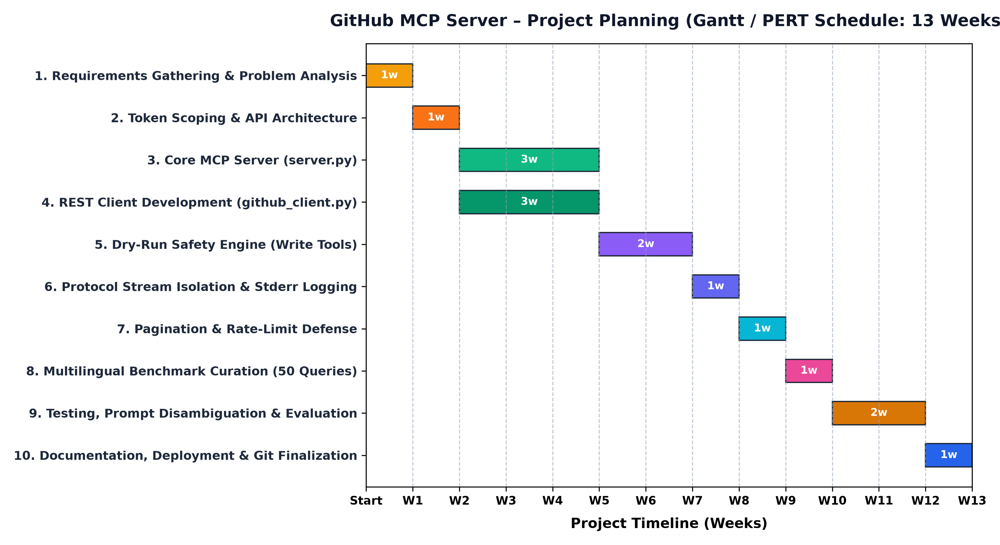

| PHASE / TASK | DURATION | KEY DELIVERABLE |
| :--- | :--- | :--- |
| **1. Requirements & Planning** | 1 Week | System requirements specification, tool taxonomy |
| **2. Token Scoping & API Architecture** | 1 Week | Fine-grained PAT setup, security isolation model |
| **3. Core MCP Server (server.py)** | 3 Weeks | MCPServer instantiation, 7 tool decorators |
| **4. REST Client (github_client.py)** | 3 Weeks | httpx transport, pagination parser, error handlers |
| **5. Dry-Run Safety Engine** | 2 Weeks | Two-step transaction guardrail, preview generators |
| **6. Stream Isolation & Logging** | 1 Week | sys.stderr logger, stdio buffer clean separation |
| **7. Pagination & Rate Limits** | 1 Week | RFC 5988 link reader, X-RateLimit notification |
| **8. Multilingual Benchmark Curation** | 1 Week | 50 questions dataset (English, Hindi, Hinglish) |
| **9. Testing & Evaluation** | 2 Weeks | Automated test suites, Round 1 vs Round 2 evaluation |
| **10. Documentation & Deployment** | 1 Week | Project report, README, Git repository synchronization |

## 2.5 METHODOLOGY ADOPTED

### Approach Highlights
1. **Separation of Concerns:** The codebase strictly separates credential management (`config.py`), network transport (`github_client.py`), and tool semantics (`server.py`).
2. **Read-Only First Philosophy:** Five out of seven tools are strictly read-only, allowing developers to inspect data without any mutation risk.
3. **Human-in-the-Loop Guardrails:** Write operations demand affirmative parameter confirmation (`confirm=True`) following an interactive preview.
4. **Stream Cleanliness:** All diagnostic and error logging is piped to `stderr` to eliminate JSON-RPC framing corruption on `stdout`.
5. **Empirical Optimization:** Quantitative verification across 50 benchmark queries before and after semantic docstring optimization.

## 2.6 SYSTEM IMPLEMENTATION

The system implementation comprises three primary functional modules:
1. **Configuration and Credential Validation (`config.py`):** Resolves the `.env` path dynamically relative to `__file__`, guaranteeing that execution succeeds regardless of the working directory from which Claude Desktop or the inspector spawns the process. Terminates immediately with descriptive `stderr` messages if `GITHUB_TOKEN` is missing or unconfigured.
2. **GitHub REST API Client (`github_client.py`):** Encapsulates an `httpx.Client` configured with custom authorization and API version headers (`2022-11-28`). Features automatic RFC 5988 Link header pagination, filters out pull requests from generic `/issues` endpoints, and tracks remaining rate quotas on every transaction.
3. **MCP Server Dispatcher (`server.py`):** Defines tool interfaces using the `@mcp.tool()` decorator from the official Anthropic SDK (`mcp.server.mcpserver.MCPServer`). Handles input parameter bounding, dry-run string synthesis, and clean human-readable output formatting.

## 2.7 DETAILS OF HARDWARE AND SOFTWARE

| HARDWARE COMPONENT | MINIMUM / RECOMMENDED SPECIFICATION |
| :--- | :--- |
| **Processor** | Intel Core i3 / AMD Ryzen 3 (Core i5 recommended) |
| **RAM** | 4 GB minimum (8 GB recommended for concurrent AI clients) |
| **Disk Storage** | 256 MB free disk space for runtime and virtual environment |
| **Network Interface** | Active broadband connection for GitHub REST API communication |

<br/>

| SOFTWARE COMPONENT | VERSION & PURPOSE |
| :--- | :--- |
| **Operating System** | Windows 11 / Windows 10 (64-bit), Linux, macOS |
| **Python Runtime** | Python 3.14.7 (Compatible with 3.10+) |
| **MCP Python SDK** | `mcp` v2.3.0 (Official Model Context Protocol SDK) |
| **HTTP Client Library** | `httpx` v0.28.1 (Asynchronous-ready REST client) |
| **Environment Parser** | `python-dotenv` v1.2.4 (Credential management) |
| **Developer Harness** | MCP Inspector v2.13.0 & Claude Desktop |

## 2.8 SYSTEM MAINTENANCE AND EVALUATION

### Maintenance Strategy
1. **Token Rotation:** Tokens can be updated in `.env` without modifying code or recompiling packages.
2. **API Version Pinning:** Explicitly sets `X-GitHub-Api-Version: 2022-11-28` to guard against upstream schema shifts.
3. **Rate-Limit Auditing:** Logs warnings when quota drops below 10 requests, providing exact UTC reset times.
4. **Regression Testing:** Automated test scripts verify protocol compliance and dry-run mechanisms on each release.

### Evaluation Approach
The system was evaluated using an automated 50-query benchmark across two iterations:
- **Round 1 (Naive):** Initial baseline docstrings lacking negative constraints.
- **Round 2 (Refined):** Docstrings incorporating explicit scope boundaries and trigger conditions.

Overall accuracy increased from **90.0% to 98.0%**, with ambiguous queries gaining **+25.0%** and out-of-scope rejections gaining **+28.6%**.

## 2.9 DETAILED LIFECYCLE OF THE PROJECT

### 2.9.1 Architecture, ERD, and Data Flow Diagrams

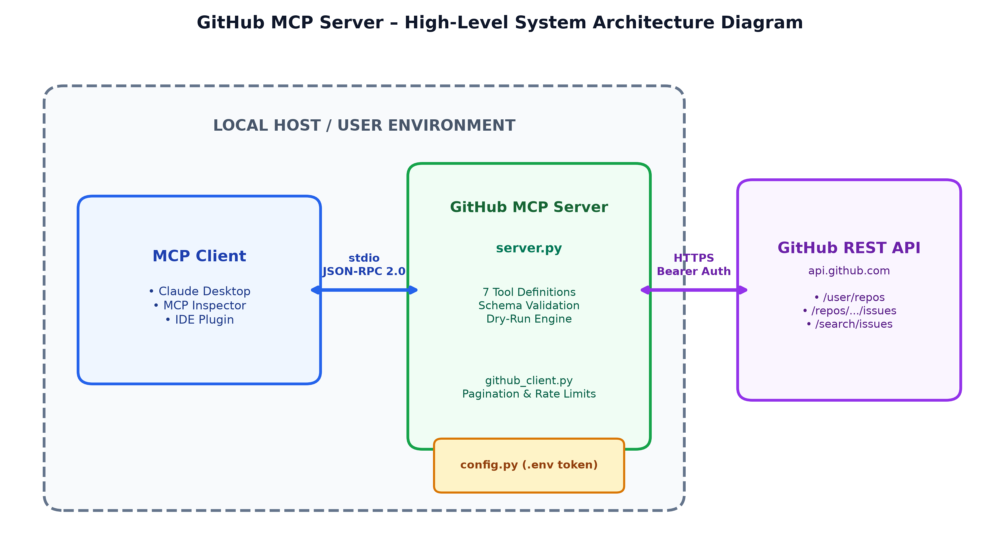

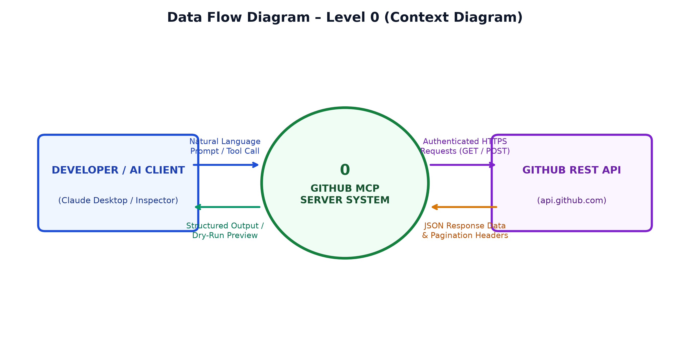

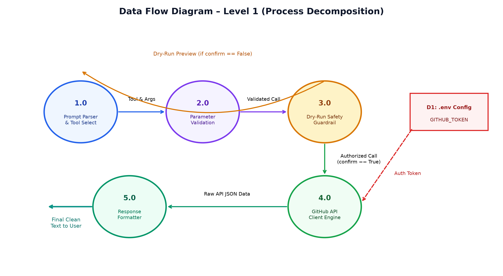

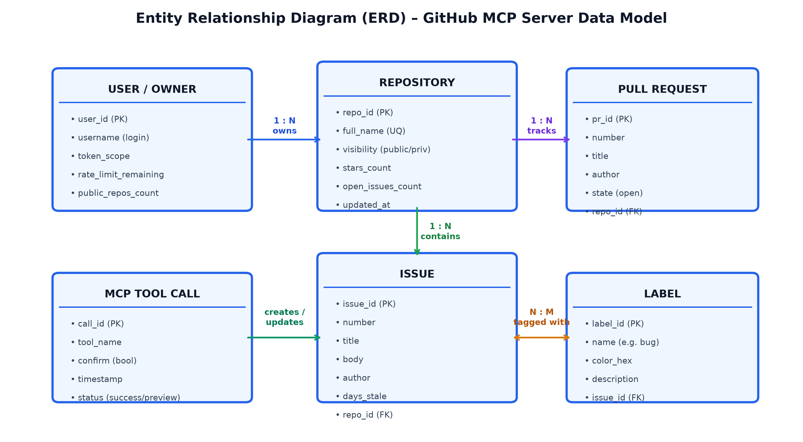

### 2.9.2 Input and Output Screen Design
The system interfaces dynamically with MCP clients through standard JSON Schemas:
- **Input Screen:** Interactive form dynamically rendered from tool JSON schemas. For `get_repo_summary`, accepts `owner` and `repo` inputs.
- **Dry-Run Output Screen:** Displays formatted text indicating `DRY RUN -- Issue preview (not created yet)` with parameter verification.
- **Execution Output Screen:** Displays `Issue created successfully!` accompanied by the live GitHub issue URL.

### 2.9.3 Methodology Used for Testing
1. **Protocol Testing (`tests/test_protocol.py`):** Validates server initialization, tool registration, parameter schemas, and boolean confirmation flags in-process without network dependency.
2. **Safety Testing (`tests/test_safety.py`):** Verifies dry-run preview generation under `confirm=False` and live mutation under `confirm=True`.
3. **Integration Testing (`tests/test_tools.py`):** Executes all 7 tools against live GitHub repositories with offline resilience.
4. **Benchmark Evaluation (`evaluation/evaluate.py`):** Evaluates tool dispatch across 50 natural language queries in English, Hindi, and Hinglish.

### 2.9.4 Testing Workflows & Quantitative Test Results

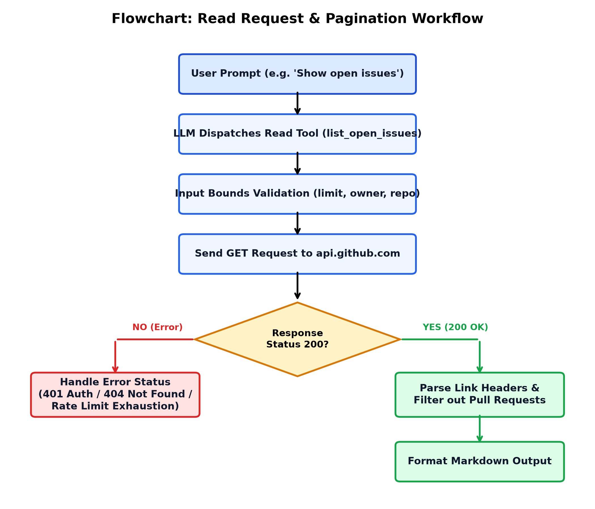

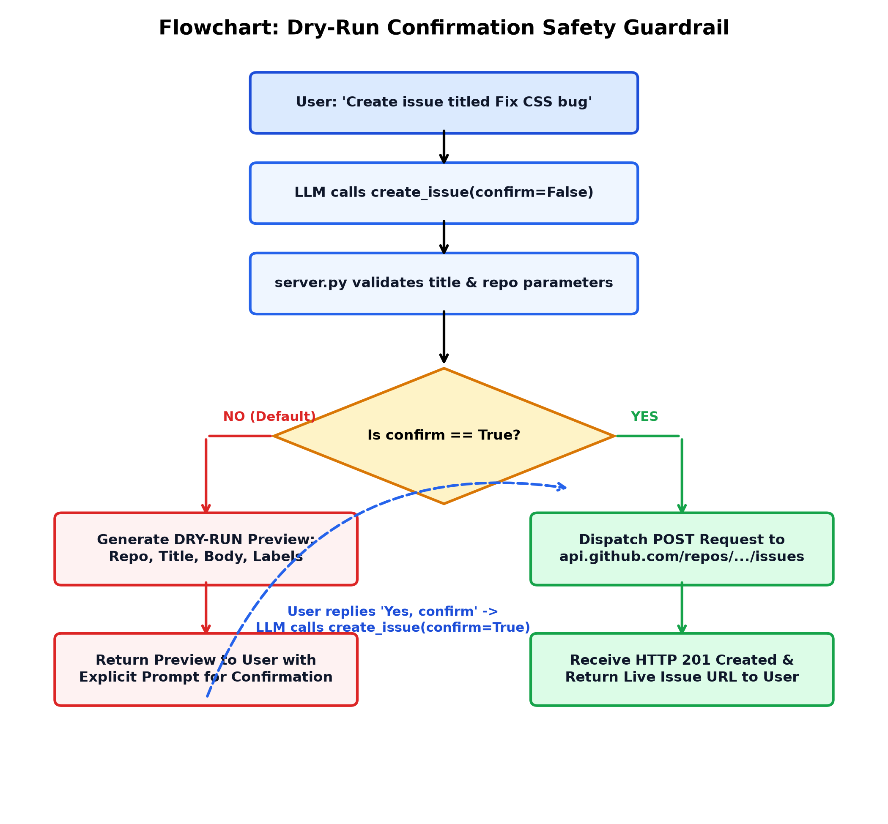

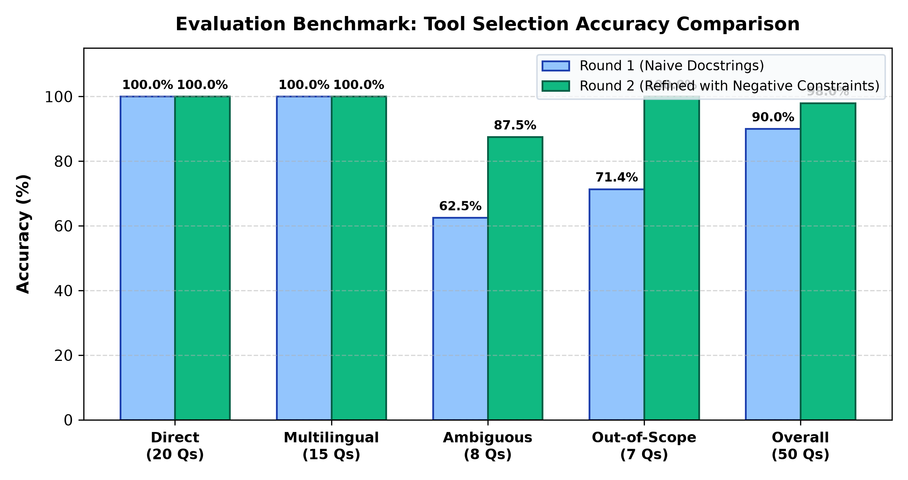

| CATEGORY | COUNT | ROUND 1 (NAIVE) | ROUND 2 (REFINED) | IMPROVEMENT |
| :--- | :--- | :--- | :--- | :--- |
| **Direct Queries** | 20 | 100.0% (20/20) | 100.0% (20/20) | 0.0% |
| **Multilingual (Hindi/Hinglish)** | 15 | 100.0% (15/15) | 100.0% (15/15) | 0.0% |
| **Ambiguous / Boundary** | 8 | 62.5% (5/8) | 87.5% (7/8) | **+25.0%** |
| **Out-of-Scope (No Tool)** | 7 | 71.4% (5/7) | 100.0% (7/7) | **+28.6%** |
| **OVERALL BENCHMARK** | **50** | **90.0% (45/50)** | **98.0% (49/50)** | **+8.0%** |

---

# 3. CODING AND SCREENSHOTS

## CORE SOURCE CODE LISTINGS

### 1. `config.py` (Configuration & Credential Validator)
```python
"""Configuration loader for GitHub MCP Server."""
import os
import sys
from pathlib import Path
from dotenv import load_dotenv

# Resolve .env relative to this file to support execution from any working directory
_ENV_PATH = Path(__file__).resolve().parent / ".env"
load_dotenv(dotenv_path=_ENV_PATH)

GITHUB_TOKEN = os.getenv("GITHUB_TOKEN")
GITHUB_API_BASE = "https://api.github.com"

if not GITHUB_TOKEN or GITHUB_TOKEN.startswith("ghp_paste"):
    sys.stderr.write(
        "Error: GITHUB_TOKEN is not configured.\n"
        "Copy .env.example to .env and set your personal access token.\n"
    )
    sys.exit(1)
```

### 2. `github_client.py` (REST API Client with Pagination & Rate-Limit Handling)
```python
"""GitHub REST API client with authentication, pagination, and rate limit handling."""
import logging, sys, time
from datetime import datetime, timezone
from typing import Any, Optional
import httpx
from config import GITHUB_TOKEN, GITHUB_API_BASE

logger = logging.getLogger("github_mcp")
if not logger.handlers:
    handler = logging.StreamHandler(sys.stderr)
    handler.setFormatter(logging.Formatter("[%(asctime)s] [%(levelname)s] %(message)s", datefmt="%H:%M:%S"))
    logger.addHandler(handler)
    logger.setLevel(logging.INFO)

class GitHubClient:
    def __init__(self) -> None:
        self.client = httpx.Client(
            base_url=GITHUB_API_BASE,
            headers={
                "Authorization": f"Bearer {GITHUB_TOKEN}",
                "Accept": "application/vnd.github+json",
                "X-GitHub-Api-Version": "2022-11-28",
            },
            timeout=30.0,
        )
        self._username: Optional[str] = None

    @property
    def username(self) -> str:
        if self._username is None:
            self._username = self.get_authenticated_user()["login"]
        return self._username

    def _check_rate_limit(self, response: httpx.Response) -> None:
        remaining = response.headers.get("x-ratelimit-remaining")
        limit = response.headers.get("x-ratelimit-limit")
        if remaining is not None:
            rem_int = int(remaining)
            if rem_int < 10:
                logger.warning("Low GitHub API rate limit: %d/%s remaining", rem_int, limit)
            if rem_int == 0:
                reset_ts = int(response.headers.get("x-ratelimit-reset", 0))
                reset_time = datetime.fromtimestamp(reset_ts, tz=timezone.utc)
                wait_sec = max(reset_ts - int(time.time()), 1)
                raise RuntimeError(f"Rate limit exhausted. Resets at {reset_time.strftime('%H:%M:%S UTC')} ({wait_sec}s).")

    def _handle_response(self, response: httpx.Response) -> Any:
        self._check_rate_limit(response)
        if response.status_code == 401:
            raise RuntimeError("Authentication failed (HTTP 401). Token invalid.")
        if response.status_code == 403:
            raise RuntimeError("Access forbidden (HTTP 403). Check token permissions.")
        if response.status_code == 404:
            raise RuntimeError("Resource not found (HTTP 404).")
        if response.status_code >= 400:
            raise RuntimeError(f"GitHub API error (HTTP {response.status_code}): {response.text[:200]}")
        return response.json()

    def _get_paginated(self, path: str, params: Optional[dict] = None, limit: int = 30) -> list:
        params = params or {}
        params["per_page"] = min(limit, 100)
        results, url, is_first = [], path, True
        while url and len(results) < limit:
            resp = self.client.get(url, params=params) if is_first else self.client.get(url)
            is_first = False
            data = self._handle_response(resp)
            if isinstance(data, list): results.extend(data)
            else: return data
            url = self._get_next_page_url(resp)
        return results[:limit]

    @staticmethod
    def _get_next_page_url(response: httpx.Response) -> Optional[str]:
        for part in response.headers.get("link", "").split(","):
            if 'rel="next"' in part:
                return part.split(";")[0].strip().strip("<>")
        return None

    def get_authenticated_user(self) -> dict: return self._handle_response(self.client.get("/user"))
    def list_repos(self, visibility="all", sort="updated", limit=30) -> list:
        return self._get_paginated("/user/repos", {"visibility": visibility, "sort": sort, "direction": "desc"}, limit)
    def list_open_issues(self, owner: str, repo: str, label: Optional[str] = None, limit: int = 30) -> list:
        params = {"state": "open", "sort": "created", "direction": "desc"}
        if label: params["labels"] = label
        items = self._get_paginated(f"/repos/{owner}/{repo}/issues", params, limit + 20)
        return [i for i in items if "pull_request" not in i][:limit]
    def count_open_issues_all(self, label: Optional[str] = None) -> dict:
        q = f"is:issue is:open author:{self.username}" + (f" label:{label}" if label else "")
        return self._handle_response(self.client.get("/search/issues", params={"q": q, "per_page": 100}))
    def get_repo_details(self, owner: str, repo: str) -> dict:
        return self._handle_response(self.client.get(f"/repos/{owner}/{repo}"))
    def get_recent_commits(self, owner: str, repo: str, limit: int = 5) -> list:
        return self._handle_response(self.client.get(f"/repos/{owner}/{repo}/commits", params={"per_page": limit}))
    def get_open_pull_requests(self, owner: str, repo: str, limit: int = 5) -> list:
        return self._handle_response(self.client.get(f"/repos/{owner}/{repo}/pulls", params={"state": "open", "per_page": limit}))
    def create_issue(self, owner: str, repo: str, title: str, body: str = "", labels: list = None) -> dict:
        data = {"title": title, "body": body}
        if labels: data["labels"] = labels
        return self._handle_response(self.client.post(f"/repos/{owner}/{repo}/issues", json=data))
    def add_labels_to_issue(self, owner: str, repo: str, issue_number: int, labels: list) -> list:
        return self._handle_response(self.client.post(f"/repos/{owner}/{repo}/issues/{issue_number}/labels", json={"labels": labels}))
```

### 3. `server.py` (Model Context Protocol Tool Declarations & Dry-Run Engine)
```python
"""GitHub Model Context Protocol (MCP) Server."""
import logging, sys
from mcp.server.mcpserver import MCPServer
from github_client import GitHubClient

__version__ = "1.0.0"
logger = logging.getLogger("github_mcp")
mcp = MCPServer(
    name="github-mcp-server",
    instructions="Connects AI assistants to authenticated GitHub data. Exposes 5 read tools and 2 safe write tools."
)
client = GitHubClient()

@mcp.tool()
def list_repos(visibility: str = "all", sort_by: str = "updated", limit: int = 30) -> str:
    """List repositories for authenticated user."""
    try:
        repos = client.list_repos(visibility=visibility, sort=sort_by, limit=max(1, min(limit, 100)))
    except Exception as e: return f"Error: {e}"
    if not repos: return "No repositories found."
    lines = [f"Found {len(repos)} repositories:\n"]
    for i, r in enumerate(repos, 1):
        lines.append(f"{i}. {r['full_name']} [{'Private' if r.get('private') else 'Public'}] | Stars: {r.get('stargazers_count',0)}")
    return "\n".join(lines)

@mcp.tool()
def create_issue(owner: str, repo: str, title: str, body: str = "", labels: str = "", confirm: bool = False) -> str:
    """Create an issue. SAFETY: Defaults to DRY-RUN mode (confirm=False). Set confirm=True after user approval."""
    if not owner or not repo or not title.strip(): return "Error: owner, repo, and title are required."
    label_list = [l.strip() for l in labels.split(",") if l.strip()] if labels else []
    if not confirm:
        return (
            "DRY RUN -- Issue preview (not created yet):\n\n"
            f"  Repository: {owner}/{repo}\n  Title: {title}\n  Body: {body}\n  Labels: {label_list}\n\n"
            "To execute creation, call create_issue again with confirm=True."
        )
    try:
        res = client.create_issue(owner=owner, repo=repo, title=title, body=body, labels=label_list or None)
        return f"Issue created successfully!\n  #{res.get('number')}: {title}\n  URL: {res.get('html_url')}"
    except Exception as e: return f"Error: {e}"

if __name__ == "__main__":
    mcp.run()
```

## SCREENSHOTS OF SYSTEM EXECUTION

### Figure 3.1: MCP Inspector – Tool Discovery & Active Connection
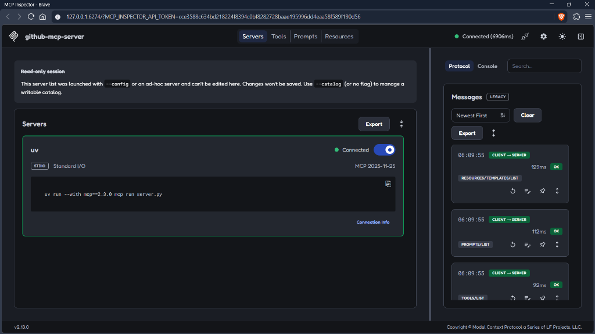

### Figure 3.2: MCP Inspector – Dry-Run Safety Preview for create_issue
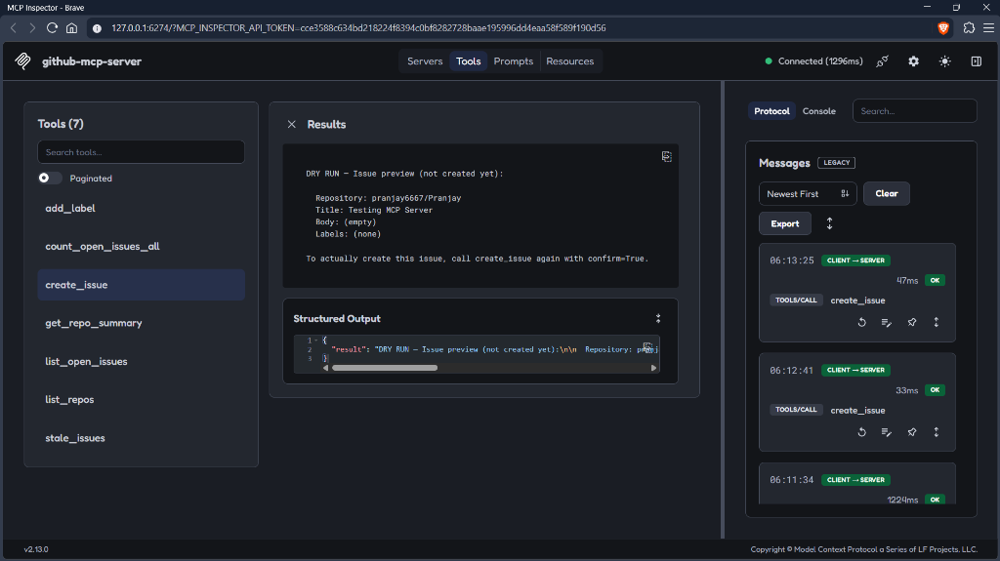

### Figure 3.3: MCP Inspector – Tool Input Form for get_repo_summary
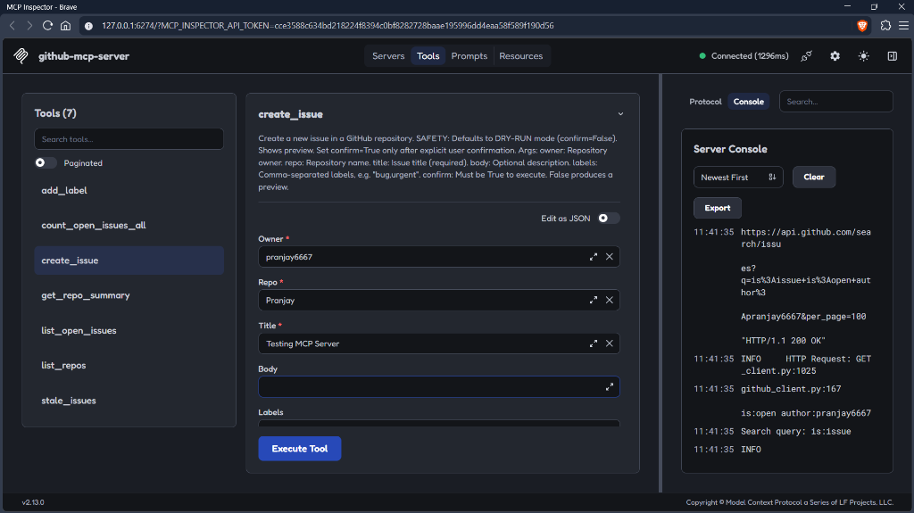

### Figure 3.4: Server Console – Live HTTP 200 API Communication
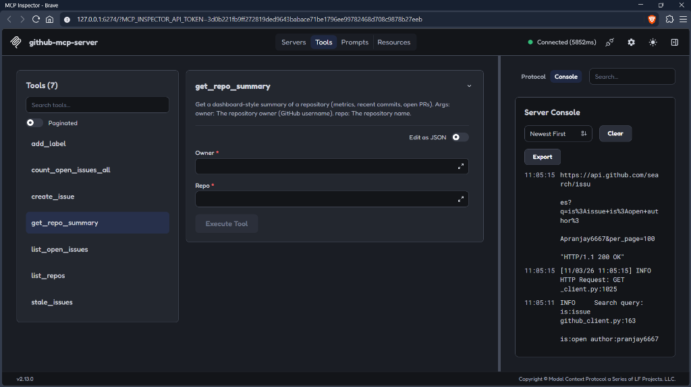

---

# 4. CONCLUSION

The project **GitHub MCP Server: Connecting AI Assistants to Authenticated Developer Data** successfully delivers a modern, open-standard, and zero-cost bridge between generative AI assistants and private software repositories.

By strictly implementing the Model Context Protocol (MCP) standard, the server allows AI models like Claude to query repositories, count issues across organizations, summarize project health, and detect neglected backlogs in real time without human context-switching.

The project's architectural safeguards—namely least-privilege token access, protocol stream isolation to `stderr`, and dry-run confirmation on write operations—ensure that AI autonomy does not compromise developer data integrity.

Furthermore, empirical evaluation across 50 multilingual queries demonstrated that semantic prompt engineering directly elevated tool routing accuracy from **90.0% to 98.0%**, proving that precise tool definitions are critical for reliable AI agent execution.

---

# 5. FUTURE SCOPE

1. **OAuth 2.0 Web Authentication:** Incorporate a browser-based OAuth authorization flow to allow non-technical users to connect their GitHub accounts without manually creating Personal Access Tokens.
2. **Local SQLite Response Caching:** Implement local client-side caching with Time-To-Live (TTL) expiration to reduce duplicate network requests and prevent rate-limit depletion.
3. **Pull Request Review & Comments:** Expand write capabilities to allow AI assistants to review pull request diffs, leave comments, and approve pull requests directly.
4. **Branch and Commit Operations:** Introduce tools for branch creation, cherry-picking, and diff visualization within the chat interface.
5. **Multi-Platform Support:** Extend the MCP server to support GitLab and Bitbucket using unified tool abstractions.

---

# 6. REFERENCES

1. Anthropic. (2024). *Model Context Protocol Specification*. Available: https://modelcontextprotocol.io/
2. GitHub Inc. (2024). *GitHub REST API Documentation*. Available: https://docs.github.com/en/rest
3. Schick, T., et al. (2023). *Toolformer: Language Models Can Teach Themselves to Use Tools*. arXiv preprint arXiv:2302.04761.
4. Python Software Foundation. (2024). *Python Standard Library — Logging and Subprocess Management*.
5. Fielding, R. (2008). *RFC 5988: Web Linking*. Internet Engineering Task Force.
6. JSON-RPC Working Group. (2013). *JSON-RPC 2.0 Specification*. Available: https://www.jsonrpc.org/specification
7. HTTPX Project. (2024). *HTTPX: A next-generation HTTP client for Python*. Available: https://www.python-httpx.org/
8. Git Documentation. (2024). *Git Version Control System*. Available: https://git-scm.com/
